<!-- GENERATED FILE. Edit scripts/profile/readme_template.md and data/profile.json, not this README. -->


I run courtroom operations at Santa Barbara Superior Court: courtroom clerks, court reporters, and court interpreters. Ten years inside California courts taught me how systems serve people, and exactly where they fall short.

In July 2025 I started building AI tools from the inside of the institution, not at it. I direct, AI generates, I validate. Nothing ships until it holds up. I also speak to court leaders about AI adoption (NACM 2026, Los Angeles Superior Court).

Off duty: Supernote devotee, Lakers lifer, and certain that earl grey hot is the correct order.

🛰️ **Open to:** roles where civic experience meets AI building. Prototyping, AI enablement, public-sector AI, or a job that didn't exist a year ago. AI-assisted building gave me wings. I want to use them where institutions and the people they serve need a translator.

🎓 **Credentials:** AWS Certified AI Practitioner · AWS AI/ML Scholar, Agent Engineer Nanodegree (2026) · Certified Court Manager (CCM) · MPA, Claremont Lincoln University · Paralegal Certificate, UCSB · BA Liberal Studies, CSU Long Beach

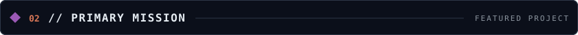

<a href="https://verity-lex.vercel.app">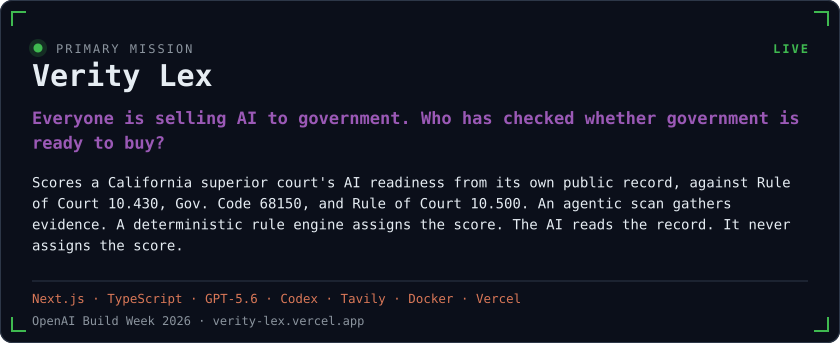</a>

🟢 <a href="https://verity-lex.vercel.app"><b>Live</b></a> · <a href="https://verity-lex.vercel.app/methods">Methods</a> · <a href="https://youtu.be/aEg4BB8-ad0">Demo video</a> · <a href="https://github.com/earlgreyhot1701D/verity-lex">Repo</a>

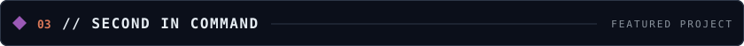

<a href="https://agentislux.io">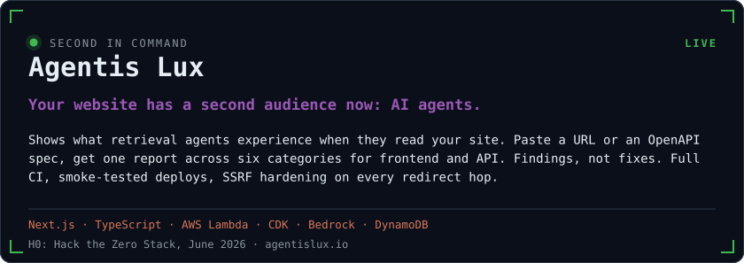</a>

🟢 <a href="https://agentislux.io"><b>Live</b></a> · <a href="https://youtu.be/bv56_XB1E_c">Demo video</a> · <a href="https://github.com/earlgreyhot1701D/perseus-clew">Repo: perseus-clew</a>

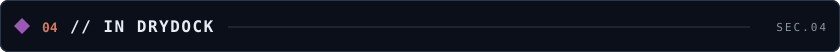

<a href="https://github.com/earlgreyhot1701D/dead-keys">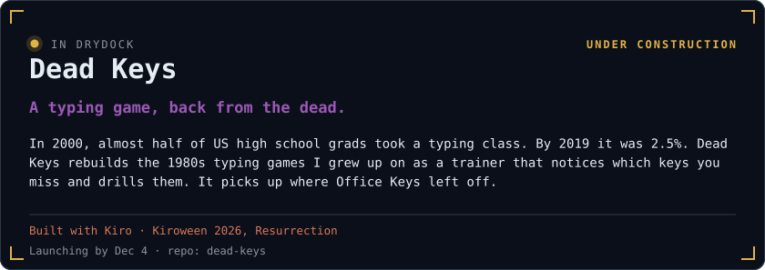</a>

🟡 <a href="https://github.com/earlgreyhot1701D/dead-keys"><b>Repo</b></a> · <a href="https://github.com/earlgreyhot1701D/dead-keys/blob/main/docs/prd.md">PRD</a> · <a href="https://github.com/earlgreyhot1701D/office-keys">Office Keys, its predecessor</a>

<a href="https://github.com/earlgreyhot1701D/observator-clew">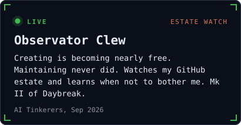</a>
<a href="https://two-sisters-tinctures.onrender.com/">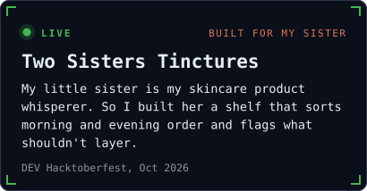</a>
<a href="https://clewdirective.com">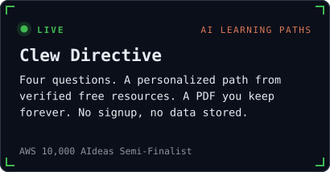</a>
<a href="https://github.com/earlgreyhot1701D/janus-clew">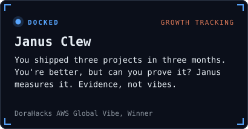</a>
<a href="https://github.com/earlgreyhot1701D/memoria-clew">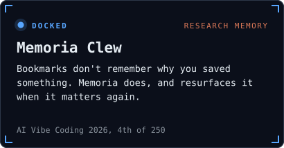</a>
<a href="https://metis-clew.vercel.app">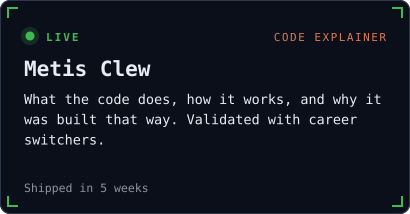</a>

<b>Full fleet roster (click to expand)</b>

 

| Vessel | Mission | Status |
|---|---|---|
| [Lumen Clew](https://github.com/earlgreyhot1701D/lumen-clew) | Code health scanner. Awareness, not shame | 🟢 [Live](https://lumenclew.lovable.app) |
| [Ariadne Clew](https://github.com/earlgreyhot1701D/Ariadne-Clew) | Turns messy LLM chat sessions into preserved reasoning | 🔵 |
| [Heimdall](https://github.com/earlgreyhot1701D/heimdall) | Tests whether an AI gateway's access controls actually hold. Evidence for a [sponsored dev.to piece](https://dev.to/earlgreyhot1701d/gating-access-with-bifrost-nine-calls-three-refusals-one-trap-46h4) | 🔵 |
| [Daybreak](https://github.com/earlgreyhot1701D/daybreak) | Always-on AWS agent that tracked everything I ship. Mk I of Observator | 🔵 |
| [Hermes Clew](https://github.com/earlgreyhot1701D/hermes-clew) | Agent readiness scanner, the proof of concept that became Agentis Lux | 🔵 |
| [Anton Clew](https://github.com/earlgreyhot1701D/anton-clew) | Policy CLI that classifies AI file changes as DENY, NEEDS_APPROVAL, or ALLOW | 🔵 |
| [README Clew](https://github.com/earlgreyhot1701D/readme-clew) | Audits your README against your code. I run it on mine. It finds things | 🔵 |
| [TicketGlass](https://github.com/earlgreyhot1701D/ticketglass) | Transparency for IT support tickets | 🔵 |
| [Athena Clew](https://github.com/earlgreyhot1701D/Athena-Clew) | Autonomous debugging agent on Gemini 3 | 🔵 |
| [Argus Clew](https://github.com/earlgreyhot1701D/argus-clew) | Agent-readiness review on every AWS commit | 🔵 |
| [Clew Quest](https://github.com/earlgreyhot1701D/clew-quest) | Open source project discovery matched to your learning goals | 🔵 |
| [Vigil Crest](https://github.com/earlgreyhot1701D/vigil-crest) | Telegram correspondent that watches the DEV challenge feed | 🔵 |
| [Clew Forge](https://github.com/earlgreyhot1701D/clew-forge) | Lightweight framework for shipping fast without losing clarity | 🔵 |
| [Propina](https://github.com/earlgreyhot1701D/propina) | USD/MXN tip calculator. One prompt, eight minutes, live | 🟢 [Live](https://earlgreyhot1701d.github.io/propina/) |
| [Steep](https://github.com/earlgreyhot1701D/steep) 🫖 | Tea leaf reading for your repo. DEV April Fools 2026, Best Use of Google AI | 🔵 |
| [Office Keys](https://github.com/earlgreyhot1701D/office-keys) | Gamified typing practice for workforce digital literacy | 🔵 |
| [Sprint-Kit](https://github.com/earlgreyhot1701D/Sprint-Kit) | PM skills for middle schoolers. Zero data collection | 🔵 |
| [Proof of Scoville](https://github.com/earlgreyhot1701D/proof-of-scoville) 🌶️ | On-chain salsa tracker. Yes, really. No regrets | 🔵 |
| [Bench Power: Lakers](https://github.com/earlgreyhot1701D/bench-power-lakers) 🏀 | Data storytelling on bench impact | 🔵 |

🟢 Live · 🔵 Docked (repo, run it yourself) · 🟡 In drydock

<a href="https://themislex.org">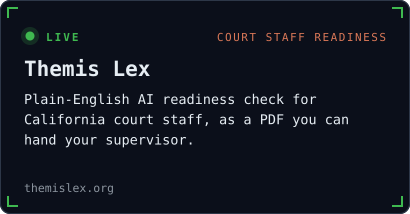</a>
<a href="https://github.com/earlgreyhot1701D/porch-light">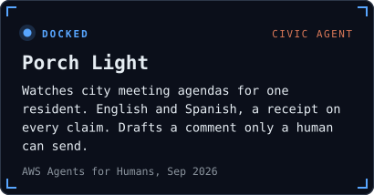</a>

<b>More away missions (click to expand)</b>

 

| Mission | What it does |
|---|---|
| [Permission to Approach the Firewall](https://github.com/earlgreyhot1701D/permission-to-approach-the-firewall) | Cybersecurity awareness program for court staff |
| [12 Angry Rows](https://github.com/earlgreyhot1701D/12-angry-rows) | 11 years of jury utilization data, benchmarked against NCSC standards |
| [Write of Access](https://github.com/earlgreyhot1701D/write-of-access) | AWS Textract on public court forms, with honest notes on what it can't do |
| [Hung Jury](https://github.com/earlgreyhot1701D/hung-jury) | The blocker was data quality, not Python. Sometimes the finding is the deliverable |
| [Panoptes Scout](https://github.com/earlgreyhot1701D/Panoptes-Scout) | First-pass data quality briefing agent for tabular datasets |

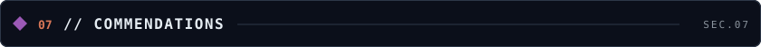

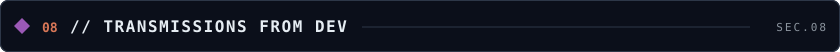

<a href="https://dev.to/earlgreyhot1701d/a-small-laptop-is-a-full-build-kit-bootstrapping-with-a-chromebook-claude-and-github-4j16">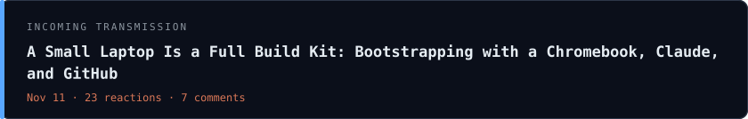</a>

<a href="https://dev.to/earlgreyhot1701d/a-builder-in-cdmx-flu-edition-167">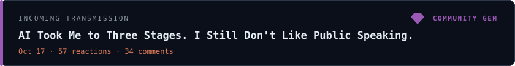</a>

<a href="https://dev.to/earlgreyhot1701d/from-one-chatbot-to-five-agents-my-aws-agent-engineer-nanodegree-69i">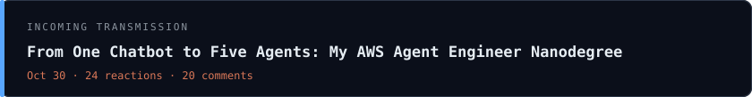</a>

💎 **4 Community Gems.** Gems are DEV's human-curated picks. Trusted curators hand out a limited number each day to spotlight work they think deserves a wider audience. No algorithm, just people with taste.

| 💎 Picked as a gem | Date |
|---|---|
| [AI Took Me to Three Stages. I Still Don't Like Public Speaking.](https://dev.to/earlgreyhot1701d/ai-took-me-to-three-stages-i-still-dont-like-public-speaking-1g38) | Oct 2026 |
| [My Agents Never Get Tired. I Do: On Satisficing](https://dev.to/earlgreyhot1701d/my-agents-never-get-tired-i-do-on-satisficing-1mb) | Sep 2026 |
| [Block Zero: Oh, no! Claude, Kiro and I over-engineered the throwaway.](https://dev.to/earlgreyhot1701d/block-zero-oh-no-claude-kiro-and-i-over-engineered-the-throwaway-5d42) | Sep 2026 |
| 💬 Plus one gem for a comment, because the conversation counts too | |

 
WeCoded Winner · Best Use of Google AI · Top 7 · 💎 Community Gems · 24-Week Streak

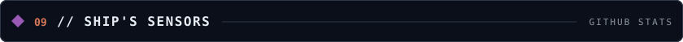

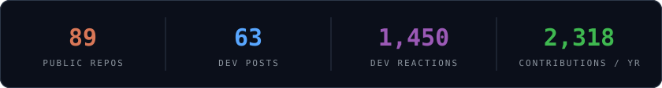


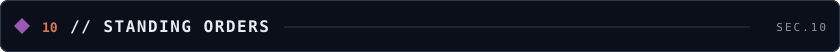

I don't write code from scratch. I give creative direction and validation: AI tools generate, I compare outputs, pick what works, and stitch it into something that holds up.

1. **Occam's Razor.** Solve one problem completely before adding the next.
2. **Single Responsibility.** Every component does one thing well.
3. **Deterministic structure, AI flavor.** Code decides. The model describes.
4. **Name the limits.** What a tool can't do goes in the docs, not under the rug.
5. **Operational Thinking.** Ten years in courts means I know implementations have consequences.

<a href="https://dev.to/earlgreyhot1701d">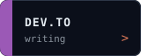</a>


This page redraws itself daily from the DEV and GitHub APIs. Last sensor sweep: 2026-11-12.
